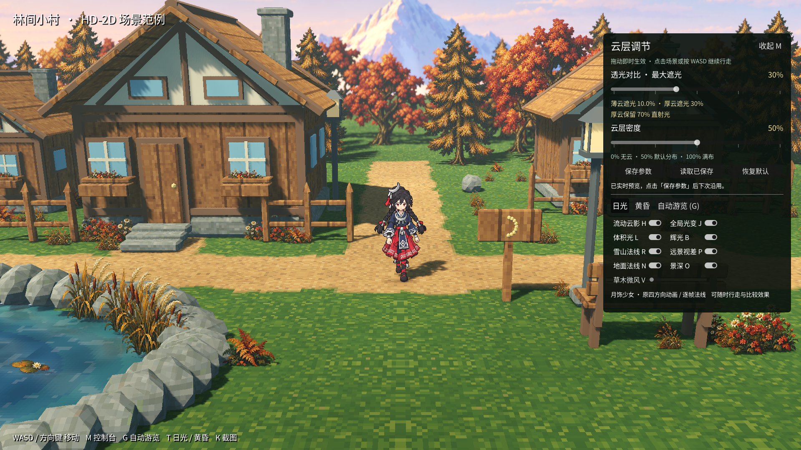
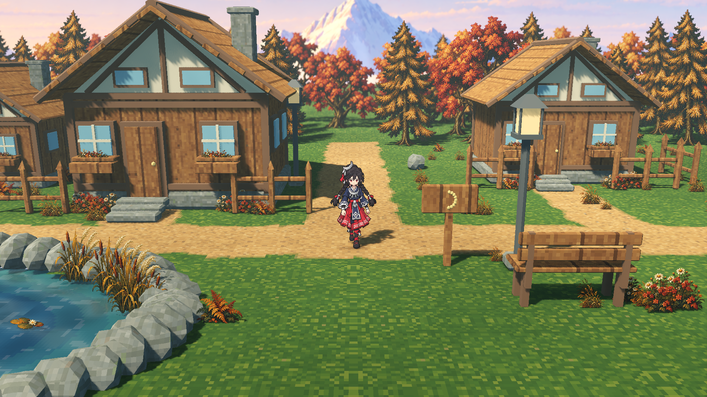
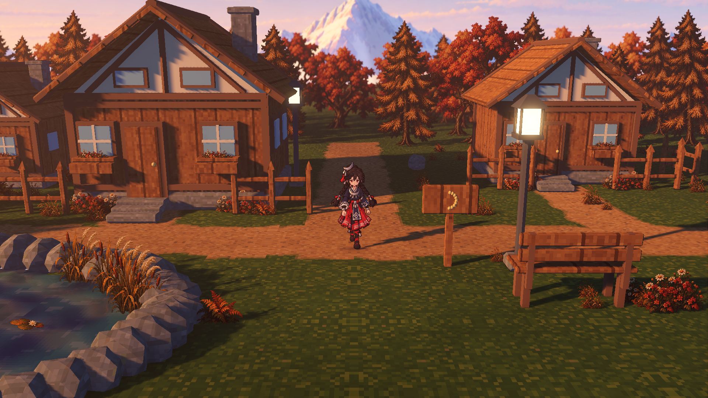

# 林间小村 · HD-2D 场景范例

推荐当前近景入口：`scenes/forest_hamlet_close.tscn`，执行 `make forest-close-run`；总览入口 `scenes/forest_hamlet.tscn` 保留。这是可实际行走的独立 Godot 场景，复用项目已有的月饰少女，将暖土路、森林木屋、石岸池塘、HD-2D 植被、雪山远景和动态光照组合为一个范例。

视觉参考为 [用户提供的 Bilibili 视频](https://www.bilibili.com/video/BV1TFjz6eEK7/) 中约 **00:13 的森林村落镜头**：暖土路、低矮木屋、密集树林、花坛和前景池塘。视频页面标注包含 AI 生成内容；本工程依据可见画面制作自己的几何、材质和渲染效果，不将视频帧作为游戏贴图，也不声称取得原视频的模型、工程或精确渲染参数。

## 2026-10-22 云层实时调节 · r4

按 **M** 打开右侧中文面板，即可亲自调整云的透光对比与密度。拖动即时生效，方向键每步微调 1 个百分点，并可保存、读取及恢复默认。

| 参数 | 可调范围 | 默认 | 效果 |
|---|---|---|---|
| 透光对比 · 最大遮光 | 0–80% | 30% | 越大则云下越暗；最厚云在最大设置下保留 20% 太阳直射光。 |
| 云层密度 | 0–100% | 50% | 0% 无云，50% 默认分布，100% 满布厚云；独立于遮光强度。 |

默认仍为薄云约削弱 10%、厚云 30%。保存后下次正常启动自动沿用；恢复默认后可再次保存。焦点在滑块上时方向键不会误让角色移动，点击场景、按 WASD 或收起面板即可继续行走。独立全局光变 J、云影 H、体积光 L、辉光 B 保留。

本轮已通过 **20 项运行、33 项真实 GPU、58 项像素检查**及 `make test`；保存了 **9 张原始 GPU 图**，包含 720p/1080p 面板与真实鼠标、键盘操作验证。AW 原生 `godot.verify`、交付校验与 VGP 后继版本登记完成，候选待用户审阅。操作细节见 [云层实时调节](cloud-tuning-r4.md)，实际截图及来源回执见 [r4 修订](revisions/cloud-tuning-r4-20261022/README.md)。



## 2026-10-22 透光云影、雪山远景与不规则全局光照 · 历史 r3

r3 将云改为柔和透光的原生投影：薄云的区域平均目标约削弱 **10%** 太阳直射，最厚云限制在 **30%**；房屋、树木和角色的实体阴影继续保留。雪山远景、法线受光、实际行走视差、原生体积雾、WorldEnvironment Glow 和独立全局光变继续使用。当前画面、最终证据及 AW / VGP 身份统一见 [雪山与氛围 r3 修订](revisions/atmosphere-r3-20261022/README.md)。

- **透光云影：** 原太阳保留总能量和天空贡献，两个同向原生方向光按 70% / 30% 分配场景日光。70% 分支仅排除云层投影，30% 分支接收云的 alpha hash 覆盖；两路都保留实体阴影。云的边缘从透明平滑进入薄云，再过渡到厚云，减少大块近黑遮挡。H 控制云影，详见 [r3 云透光技术记录](cloud-lighting-r3.md)。
- **远景构图与视差：** 原画保持 1983×793 比例与颜色文件原字节，整块背景板横移至中央树冠开口；主峰顶部允许少量裁切，露出成组雪脊。角色左右行走时，村庄与这块远景之间产生相对视差；画内山层没有拆成独立移动素材。
- **山体受光：** 根据手工标注的 10 个山体、20 个大片面生成技术法线，按实际太阳方向做温和动态重光照。天空与下部雾保持平法线，法线不由颜色亮度反推高程。
- **不规则全局光变：** 独立模块继续用固定种子 **20261022** 的多尺度平滑时间噪声，分别驱动原生太阳和环境补光。太阳相对昼夜基值的倍率边界为 **0.82–1.18**，环境为 **0.90–1.10**；这是 ±18% / ±10% 的硬边界，实际变化不必达到边界。J 键控制，云的空间位置不决定这项全局变化。r3 两个场景光读取变化后的总能量再分配，不累乘。见 [全局光照](global-lighting.md)。
- **体积光与光晕：** 低密度原生体积雾提供空间散射，Glow 扩散亮部，分别由 L / B 控制；云层、全局能量、体积雾和 Glow 有各自对照。
- **沿用的镜头与素材：** 默认近机位仍为 14° 俯角、39° FOV；角色完整动画可见范围的设计占比为画高 23.24485%。原 345 个角色文件与 218 个植物精灵继续使用，植物仍为颜色图 + 法线图 Sprite3D；本轮回归以 r3 报告为准。

r3 完整验收集合包括 **18 张场景对照 + 8 张专用透光探针 PNG**。透光比例采用固定线性色调映射、关闭环境及后期效果的探针，做经半能量校准的逆 sRGB 线性估计；普通游戏截图用于观察美术效果，不能直接按显示码值推算 10% / 30%。最终快照复验已测得薄云三个区域平均约 89.61%–89.69% 透光，厚云约 69.73%，其 8-bit 量化区间包含 70%；结果与先行原型一致，原始画面与报告随 r3 快照归档。

[全局光变初版 r2](revisions/atmosphere-r2-20261022/README.md)、[云影初版 r1](revisions/atmosphere-r1-20261022/README.md) 及以下植被、近景镜头和 pixel-r2 小节保留为制作历史；当前调节面板及参数范围以上方 r4 修订为准；r3 图像和计数保留为历史证据。

## 2026-10-22 秋色 HD-2D 植被修订

按用户新提供的秋色植被参考重画十类植物：红铜阔叶、金色针叶、草丛、蕨类、芦苇、花簇、窗花与睡莲。当前两个场景入口均使用 **218 个颜色图 + 法线图 Sprite3D，其中 67 棵树**；运行场景不再加载立体植物模型。近景继续保持 14° 俯角、39° FOV 与原角色比例，并降低远林景深强度，使中景叶簇可读。

这一轮植被原稿、制作来源、AW / VGP 身份和当时的实际验证见 [秋色植被修订](revisions/vegetation-r2-20261022/README.md)。这些植物继续用于当前场景；该目录与下方 pixel-r2 的计数和截图保留为对应版本的制作记录。

## 2026-10-22 江南参考角度近景版

用户后续提供的低俯角截图对应独立近景入口 `scenes/forest_hamlet_close.tscn`，执行 `make forest-close-run`。该版本使用 14° 低机位、原人物比例和更近的构图，并包含前景树遮挡渐隐。具体参数、实际截图与完整行走验证见 [近景镜头修订](camera-reference-20261022/README.md)。

## 2026-10-22 像素材质、角色比例与参考机位修订

本次按用户补充的村落截图重新构图；输入原图保存在 `art/inputs/forest-hamlet/camera-reference-20261022.png`，只作为构图依据。角色居中、脚底约在画面高度 57%，池塘保留在左下前景，村屋与树群位于上方。

| 项目 | pixel-r2 总览机位实现 |
|---|---|
| 相机偏移 / 俯角 | `(0, 12, 17.5)` / 34.44° |
| 相机到跟随焦点距离 | 21.22 m；初版为 26.51 m，约拉近 20% |
| 视场角 | 39°，保持透视投影 |
| 角色构图 | 完整 108 帧可见范围约占画高 13.60%；脚底为 `(50.0%, 56.93%)` |
| 跟随 | 水平位置 1:1 跟随、指数平滑、场景边界限制，焦点高度固定 |
| 角色比例 | 原 `pixel_size = 0.009`、原脚底枢轴与单位缩放；完整相机 billboard 保持长宽比 |
| 环境材质 | 四张 64×64、共享 64 色来源色板、nearest 采样、16 texel/m |

角色 shader 使用主相机的完整朝向，并同步法线矩阵；俯视和侧转不再压缩角色高度。四方向原动画仍按移动方向切换，精灵平面始终朝向镜头。共用 shader 的新开关默认关闭，仅此场景启用。

前景树冠遮住角色时会渐隐，离开遮挡区域后恢复；镜头可见的外围地面补齐，避免走到左侧时出现网格外空白。

地表、木屋、石岸与道具统一像素密度，木纹和石纹压低对比；路径混合、植物色簇与水纹采用有限层级。立体光照、阴影和角色保护景深继续由 Forward+ 渲染。

本版完整证据见 [pixel-r2 修订](revisions/pixel-r2-20261022/README.md)。原 `captures/`、`evidence/` 和 r1 来源快照保留为历史，不代表当前实现。

## 运行

在项目根目录执行：

```sh
make forest-close-run
```

总览版本执行 `make forest-run`。也可以在 Godot 编辑器中打开 `scenes/forest_hamlet_close.tscn` 或总览的 `scenes/forest_hamlet.tscn` 后按 F6。原项目默认入口仍为江南河街。直接运行这个范例只需要现有 Godot 与图形桌面，不需要启动 AW、VGP 或 Blender。

| 操作 | 功能 |
|---|---|
| WASD / 方向键 | 行走；输入会接管自动游览 |
| T | 日光 / 黄昏 |
| G | 沿六个路点自动游览，使用真实角色移动与碰撞 |
| M | 打开 / 收起中文效果控制台 |
| N | 地面法线开关 |
| B | WorldEnvironment Glow 光晕开关 |
| O | 景深开关 |
| V | 植物微风开关 |
| P | 雪山背景板相对视差开关 |
| R | 雪山法线重光照开关 |
| H | 流动云影开关 |
| J | 不规则全局太阳 / 环境补光变化开关 |
| L | 原生体积雾 / 空间光散射开关 |
| K | 保存当前截图，界面显示位置 |
| Esc | 先取消游览或关闭面板；退出需确认 |

F8 / F9 留给编辑器停止 / 暂停。场景输入通过独立角色适配器处理，不修改共用 InputMap。

## 画面与场景组成





全局光变初版的 [r2 日光](revisions/atmosphere-r2-20261022/close-day-clouds-a.png)、[r2 黄昏](revisions/atmosphere-r2-20261022/close-dusk-atmosphere.png)，以及云影初版的 [r1 日光](revisions/atmosphere-r1-20261022/close-day-clouds-a.png) 与 [r1 黄昏](revisions/atmosphere-r1-20261022/close-dusk-atmosphere.png) 保留。此前植被版本的 [近景](revisions/vegetation-r2-20261022/close-normals-on.png) 与 [总览](revisions/vegetation-r2-20261022/overview-day.png) 保留，便于比较加入雪山和空间光照前后的构图。

地面由真实可碰撞网格承载。世界坐标材质把草地和土路连续混合，路缘带有小尺度不规则变化；草地的大色块优先于颗粒，避免与角色争夺注意。地面微法线是独立编写的解析表面信号，没有从颜色图明暗反推固定阴影。

木屋有完整墙体、三角山墙、屋檐、独立木瓦层、屋脊、窗框、侧窗、台阶、烟囱和花箱。结构道具保留 Blender 来源；房屋源模型移除 24 个植物节点后导出为 `cottage_without_plants.glb`，由三栋房屋复用，六组窗花另以精灵放置。阔叶与针叶树、草花和水生植物全部使用相机朝向的颜色/法线图，按可见像素高度统一换算世界尺寸。多排深度和统一缩放差异形成遮挡与视差，法线参与实时受光。

池塘使用独立水面、石岸与岸边碰撞。水面包含蓝绿深浅色、动态法线、不规则短波和局部闪光，并使用 Forward+ 屏幕空间反射。屏幕外对象不在 SSR 可反射范围内；水面仍有天空反射回退。闪光包含美术编写的信号，不应将其误记为完整物理水模拟。

光照提供日光与黄昏两组设置。暖色太阳、冷色环境光、实际投影与接触遮蔽构成村庄层次，上空云层随时间移动，在保留至少 70% 直射能量的分支结构内，让不同物体获得连续的空间明暗变化；实体自身遮挡仍可以形成完整阴影。独立全局光变同时缓慢改变源太阳及环境补光的能量幅度，其计时与开关不依赖云的位置，也不改全屏曝光或原图颜色。原生体积雾参与空间散射，WorldEnvironment Glow 在亮部形成光晕；两者分别控制并保留实际像素对照。景深焦点保护角色所在区域，原角色逐帧法线与银饰材质继续参与受光。

雪山使用位于视深 135 米的一块完整远景板。单板相对视差、法线重光照与昼夜配色由背景模块同步，原图长宽比不变。画中已经绘制的受光颜色仍被保留，因此法线用于温和改变大面明暗，不能消除原画光照或生成新的山体几何阴影。

## 角色与资产来源

- 月饰少女沿用原四方向、每方向 27 帧，共 **108 帧**。颜色、法线、银饰蒙版与相关定义的 **345 个原文件**以 SHA-256 基线核验，未被本轮制作覆盖。
- 本版运行 **4 张 64×64 材质**（共享 64 色来源色板；初版 256×256 输出留在 AW 历史）：草地、土路、木板、苔石。原始 ImageGen 母图与完整提示词保留；工具没有提供可记录的模型版本与 seed，来源记录明确为 null。
- 历史制作保留 **9 个模型组件**及其固定 seed、Blender 版本和摘要。当前运行只使用结构道具，以及新增的无植物房屋模型；broadleaf、fir、grass 和含植物原房屋不再实例化。
- 当前植物使用 **10 对颜色/法线图**。秋色原稿、用户参考、提示词、192 色来源色板、逐叶簇/枝干法线标注、原生 AW 配方与 VGP 候选均保留。
- 雪山源画位于 `art/inputs/forest-hamlet/snow-r1/source/snow-master.png`，1983×793；运行颜色图逐字节一致。`normal-rig.json` 保留 20 个大片面的手工标注，生成器与输出摘要保留在同一来源链中。技术说明见 [雪山记录](../../art/inputs/forest-hamlet/snow-r1/technical-notes.md)。
- 原创几何保留 `.blend` 与生成脚本。固定几何 seed 便于重现结构；不同 Blender 版本和文件元数据仍可能造成二进制编码差异。

详细步骤见 [AW / VGP 工作流](pipeline.md)。r3 使用新的原生 `godot.verify` 运行与源码快照，再执行 `delivery export` / `delivery verify`；交付记录包含原色、法线和区域三张运行贴图及该原生运行中的选定源码与验证证据。**18 张场景图和 8 张透光探针**由工程独立进行实际 GPU 捕获与分析，再冻结并关联 VGP 后继候选。VGP 保留原 Asset、直接附带画面 PNG，并以确定性的 `evidence.zip` 携带其余完整依赖；最终身份、附件清单和状态见 [r3 修订记录](revisions/atmosphere-r3-20261022/README.md)。此前 `world.compile` 属于地面材质和植被颜色加工链；r3 不重新量化雪山颜色原图，也不把独立 GPU 图归为 AW 渲染。

## 验证与证据

### 当前 r3

本轮最终验收已完成：**15 项资源 / 58 项运行 / 47 项场景 GPU / 80 项场景像素检查通过**，透光探针另通过 **24 项捕获 / 67 项像素检查**。26 张原始图、真实路线、原生 AW 回执与 VGP 后继状态统一登记于 [r3 验收记录](revisions/atmosphere-r3-20261022/README.md)。以下均为本轮最终快照结果。

| r3 证据组 | 内容与状态入口 |
|---|---|
| 已完成资源 / 运行检查 | **15 项资源、58 项运行检查通过**；本轮运行合同执行耗时 25.142 秒 |
| 已完成原生 AW `godot.verify` | **completed，58 项检查**；本轮新源码快照 **1556 文件、110438597 字节**，执行耗时 37.26 秒 |
| 已完成既有内容回归 | 既有资源 **48**、植被资源 / 运行 **126 / 28**、近景 **27**、总览 **81** 项全部通过；这些是 r3 实际计数 |
| 已完成项目共用功能回归 | **`make test` 通过**，执行耗时 11.131 秒；测试耗时不作为帧率 |
| 完整场景 GPU 与路线 | **18 张 1920×1080 原始 PNG，47 项 GPU / 80 项像素检查通过**；真实路线 **6/6 路点、22.45 秒**；含新增薄云 / 厚云 / 自然密度三图及既有各项对照 |
| 透光探针 GPU | **8 张 1024×768 原始 PNG，24 项捕获 / 67 项像素检查通过**；固定灰色接收面，暗场 / 全能量 / 半能量 / 透明云 / 薄云 / 重复薄云 / 厚云 / 自然云，与场景捕获使用同一运行文件指纹 |
| 最终透光测量 | 薄云均值约 **0.8961–0.8969**；厚云估计 **0.69725654**，量化区间 **[0.68249407, 0.71205134]** 包含 0.70；半能量 **0.49215860**，实体阴影亮度比 **0**；与先行原型同方案结果一致 |
| 解释边界 | 比例是经半能量校准的 8-bit PNG 逆 sRGB 线性估计；细尺度 alpha hash 有覆盖起伏，静态重复稳定不等于任意运动无颗粒；详见 [r3 技术记录](cloud-lighting-r3.md) |
| AW 交付与 VGP 后继 | AW `delivery export` / `delivery verify` **completed**，工程独立证据闭包 **82 项**；VGP **31 个实际附件 / 84 项逻辑来源**，技术 `ready=true`、`issues=[]`，阶段 `concept_design`、状态 `pending_review`；确切身份和回执见 [r3 修订记录](revisions/atmosphere-r3-20261022/README.md) |
| 最终归档 | **核验通过，63 个证据文件 = 26 PNG + 37 JSON**；加修订 README 共 64 个文件，详见 [归档索引](revisions/atmosphere-r3-20261022/validation.json) |

云影对照固定全局时钟到 t=0；全局强弱对照关闭云遮挡；雪山方向探针关闭全局光变。专用透光探针另外关闭环境、雾、Glow 等贡献，保留真实实体投影，用独立对照检查云层的 10% / 30% 目标及房屋树木阴影没有被一并削弱。

最终全局强 / 弱对照的平均绝对 RGB 差约 **8.730**，约 **91.93%** 像素超过 2 级阈值；关闭全局光变后相对中性 t=0 平均差约 **0.023**，没有像素超过该阈值。雪山左右光方向差为法线开启约 **2.284**、关闭 **0**；有效雪脊地标在真实左右行走中实测横移 **−97 px**，预测 **−96.5705 px**，局部匹配灰度误差约 **0.828**。Glow 与体积雾分别保留独立实际像素对照。技术验收完成，VGP 美术审阅仍待用户决定。

### 历史 r2：全局光变初版

以下计数和状态属于已归档 [r2 验收记录](revisions/atmosphere-r2-20261022/README.md)。该次 AW 交付与校验已完成；VGP 记录为 `ready=true`、`pending_review`，技术通过没有自动变为用户美术批准。r2 的旧画面、归档、原生回执和审阅轮次保留。

| r2 历史检查 | 当时结果 |
|---|---|
| 资源 / 运行 / GPU / 像素检查 | **15 / 47 / 26 / 65 项全部通过** |
| 实际画面与路线 | **15 张** 1920×1080 实际 GPU PNG；真实角色路线 **6/6** 路点完成，耗时 **22.45 秒** |
| 不规则全局光变 | 固定种子 0–90 秒按 1 秒间隔采样：太阳约 0.9161–1.1210 倍（57 秒最弱、84 秒最强），环境约 0.9441–1.0688 倍；t=0 均为 1。云影关闭后，强 / 弱 GPU 图平均绝对 RGB 差约 **8.727**，约 **91.93%** 像素超过 2 级变化阈值 |
| 云遮挡、雪山法线与视差、体积雾、Glow | 云影在地面、房屋、植被上的空间变化通过；雪山左右光方向差为法线开启约 2.284、关闭为 0；雪脊实测横移 −97 px；体积雾与 Glow 分别通过独立像素对照 |
| 相机、角色与既有内容回归 | 默认 14° / 39° FOV、角色画高 23.24485% 保持。既有资源 48 项、植被资源 / 运行 126 / 28 项、近景 27 项、总览 77 项全部通过 |
| 项目共用功能 | **`make test` 通过**，r2 执行耗时 8.946 秒 |
| 原生 AW `godot.verify` | **completed，47 项检查**；实际验证快照为 **1549 个文件、110349949 字节** |
| AW 交付校验与 VGP | 最终身份、回执和状态见 [r2 修订记录](revisions/atmosphere-r2-20261022/README.md) |

r2 在云影初版的 12 图集合上，增加云影关闭条件下的全局光变 [强光](revisions/atmosphere-r2-20261022/close-day-global-strong.png)、[弱光](revisions/atmosphere-r2-20261022/close-day-global-weak.png) 和 [关闭](revisions/atmosphere-r2-20261022/close-day-global-off.png) 三图。云影对照把全局光变固定到倍率为 1 的 t=0；法线方向探针关闭全局光变。关闭全局光变后，相对 t=0 中性基线的平均 RGB 差约 0.081，超过 2 级阈值的像素为 0；该 r2 结果是容差内一致，不是 PNG 逐字节相同。实际采样区间由引擎读取，不把 ±18% / ±10% 边界写成必达峰值。

[历史 r1 验收](revisions/atmosphere-r1-20261022/README.md) 已通过 15 / 34 / 20 / 41 项资源、运行、GPU、像素检查，保存 12 张 PNG 并完成 6/6 真实路点。该版雪山左右光方向差为法线开启约 2.284、关闭为 0；雪脊实测横移 −97 px（预测 −96.5705 px，灰度误差约 0.827）。旧植被、近景、总览与 `make test` 当时均通过；这些结果仅指 r1，不替代 r2 全局光变或 r3 透光云影的验收。

此前植被修订见 [植被历史验证摘要](revisions/vegetation-r2-20261022/validation.json)：126 项图像/法线检查、28 项植被运行检查、27 项近景检查、11 张实际 GPU 截图及 45 项像素对照检查。

以下是 [pixel-r2 历史验证摘要](revisions/pixel-r2-20261022/evidence/validation.json)，记录当时的 48 项资源检查、61 项场景运行检查与 22 张 GPU 截图，覆盖：

1. 原始母图、AW 官方输出与运行副本摘要；贴图尺寸、透明度；角色原文件不可变性；九个模型的来源和 GLB 格式。
2. 无窗口真实移动、动画帧序、四方向法线、效果开关独立性、池塘阻挡、路线取消与六路点完成。
3. 实际硬件 Forward+ GPU 渲染的 1920×1080 截图，包含日光、黄昏、角色特写、控制台、路线节点，以及地面法线 / 景深 / 辉光对照。
4. 对照截图冻结角色物理、场景更新、风与水流，使用静态天空。GPU 报告记录每张图的状态、摘要和视口绘制计数。
5. 原项目 `make test` 共用功能回归。
6. 角色在 15° / 35° / 60° 俯角、55° 侧转和 1.25 倍缩放下的真实 GPU 轮廓读回；验证长宽比、相机角度不变性与缩放。

pixel-r2 历史证据入口：

- [Billboard GPU 轮廓测量](revisions/pixel-r2-20261022/evidence/billboard-gpu-report.json)
- [运行检查](revisions/pixel-r2-20261022/evidence/runtime-report.json)
- [GPU 检查与截图状态](revisions/pixel-r2-20261022/evidence/gpu-report.json)
- [实际捕获对应的运行文件指纹](revisions/pixel-r2-20261022/evidence/runtime-fingerprint.json)
- [AW 材质处理摘要](revisions/pixel-r2-20261022/evidence/materials-summary.json)
- [VGP 候选与审批身份](revisions/pixel-r2-20261022/evidence/vgp-summary.json)
- [角色特写](revisions/pixel-r2-20261022/captures/crescent-traveler-close.png)
- [中文控制台](revisions/pixel-r2-20261022/captures/controls.png)
- [地面法线开启](revisions/pixel-r2-20261022/captures/ground-detail-normals-on.png) / [关闭](revisions/pixel-r2-20261022/captures/ground-detail-normals-off.png)
- [黄昏路灯辉光开启](revisions/pixel-r2-20261022/captures/dusk-glow-on.png) / [关闭](revisions/pixel-r2-20261022/captures/dusk-glow-off.png)

在上述 pixel-r2 历史捕获中，日景辉光整幅开关差异低于该报告的 2 级 RGB 变化阈值；黄昏路灯的对照记录了局部可测差异。材质法线和景深的对照也分别保存，避免把每个开关都描述成明显的全屏效果。

这些检查确认工程行为和实际渲染。与参考的美术相似程度仍需结合截图判断；技术检查不会自动创建用户美术批准或 VGP 的后续阶段入库。

## 重建命令

当前雪山技术贴图与氛围验证使用独立工具。以下在项目根目录执行，复用已存在的验证 Python 环境，并使用新输出目录保留已冻结证据：

```sh
build/forest-hamlet/validation-env/bin/python tools/forest_hamlet/prepare_snow_backdrop.py
build/forest-hamlet/validation-env/bin/python tools/forest_hamlet/run_atmosphere.py assets --output build/forest-hamlet/atmosphere-next
build/forest-hamlet/validation-env/bin/python tools/forest_hamlet/run_atmosphere.py test --output build/forest-hamlet/atmosphere-next
build/forest-hamlet/validation-env/bin/python tools/forest_hamlet/run_atmosphere.py capture --output build/forest-hamlet/atmosphere-next
make test
```

准备脚本只生成技术数据与颜色原字节副本，不重画雪山。当前完整 `capture` 自动采集 18 张场景图、真实六路点行走，以及输出目录 `cloud-transmission/` 内的八张透光探针，再分别分析；`--preview` 或 `--no-route` 只用于迭代，不能作为完整验收。r3 的新原生验证、AW 交付、VGP 后继登记和归档请使用 [显式版本命令](pipeline.md#当前交付登记与归档命令)。源码、验证工具或导入新增文件后应另分配 run / snapshot，不能用变化后的工程覆盖 r2 或本轮已经冻结的快照。流程与最终回执见 [工作流](pipeline.md) 和 [r3 修订](revisions/atmosphere-r3-20261022/README.md)。

以下命令保留为地面材质与最初模型链的重建入口；它们不替代上述氛围验收：

```sh
python3 tools/forest_hamlet/prepare_materials.py
python3 tools/forest_hamlet/process_materials_aw.py
make forest-models
make forest-import
make forest-test
python3 tools/forest_hamlet/run.py capture --output build/forest-hamlet/capture-new
make test
```

`GODOT` / `BLENDER` 可以指定已安装的程序；命令不会安装软件或启动服务。完整捕获会执行真实行走路线。只在调整静态画面时可添加 `--no-route`，这种捕获不会作为完整路线证据。

修改源图、配方或加工规则时，为 AW 使用新的 `--run-id`，保留既有原生记录；修改 VGP 候选资源时同样使用新的运行身份并复用原 Asset。不要覆盖已经冻结的请求来绕过版本检查。

## 文件位置

| 路径 | 内容 |
|---|---|
| `scenes/forest_hamlet_close.tscn` / `scenes/forest_hamlet.tscn` | 当前近景 / 总览入口 |
| `scripts/forest_hamlet/` | 场景、世界组装、雪山远景、云遮挡、全局光变与角色输入适配 |
| `shaders/forest_hamlet/` | 草土混合、统一像素密度道具、水面、植物风动、雪山受光与云遮挡 |
| `assets/forest-hamlet/` | 四种地表材质、结构 GLB、十对植被颜色/法线图和雪山背景；历史原模型保留 |
| `assets/forest-hamlet/backdrop/` | 颜色原字节副本、技术法线、区域图与 manifest |
| `art/inputs/forest-hamlet/` | 原图、提示词、配方、复用基线、可编辑模型 |
| `art/inputs/forest-hamlet/snow-r1/` | 雪山原画、手工法线标注与技术说明 |
| `art/derived/workbench/world/` | 既有材质与植被 `world.compile` 原生执行记录 |
| `art/derived/forest-hamlet/` | 加工摘要、AW 验证与交付校验回执、VGP 驱动回执 |
| `.vgp/` | 原生 VGP 项目资源与历史 |
| `tools/forest_hamlet/` | 准备、加工、模型、登记、运行与捕获工具 |
| `tests/forest_hamlet/` | 场景运行与氛围契约检查 |
| `docs/forest-hamlet/revisions/atmosphere-r3-20261022/` | 当前 r3 画面、透光探针、验证与 AW / VGP 身份入口 |
| `docs/forest-hamlet/revisions/atmosphere-r2-20261022/` | 全局光变初版的历史截图、验证与回执 |
| `docs/forest-hamlet/revisions/atmosphere-r1-20261022/` | 雪山与云影初版的历史截图和证据 |
| `docs/forest-hamlet/cloud-lighting-r3.md` | 当前透光云影、70% / 30% 原生太阳分支与校准测量方法 |
| `docs/forest-hamlet/global-lighting.md` / `cloud-lighting.md` | 沿用的全局能量模块 / r1-r2 云影历史技术记录 |

含本机路径的原生工作流记录在当前工程内保留，并排除于 git；可携带的相对路径摘要和最终画面在本目录。`build/` 保存过程日志及迭代捕获。本轮没有提交或推送代码。

范例聚焦视频中森林村落这一种环境；房屋室内、战斗、四季变化和任务系统不在此场景中。
