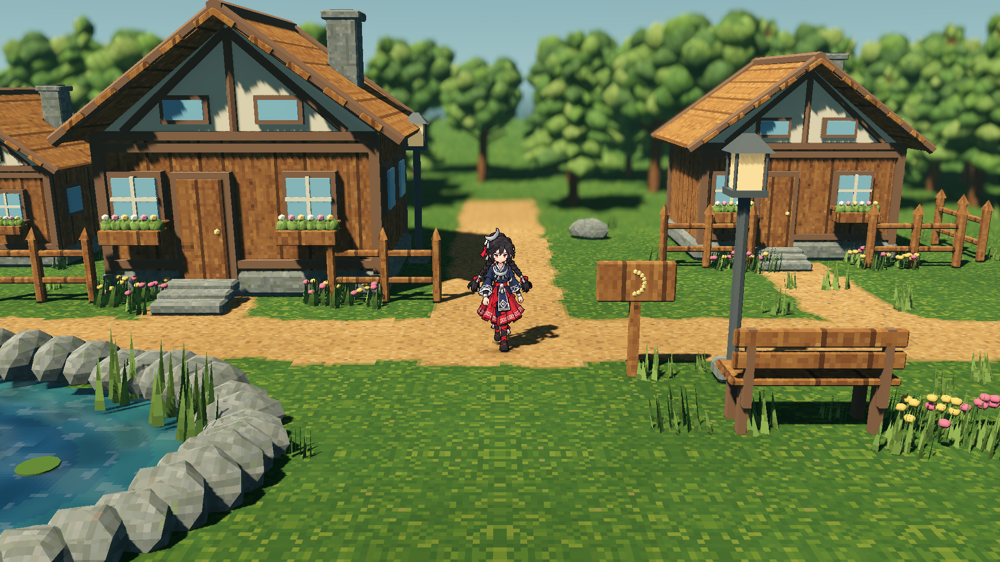
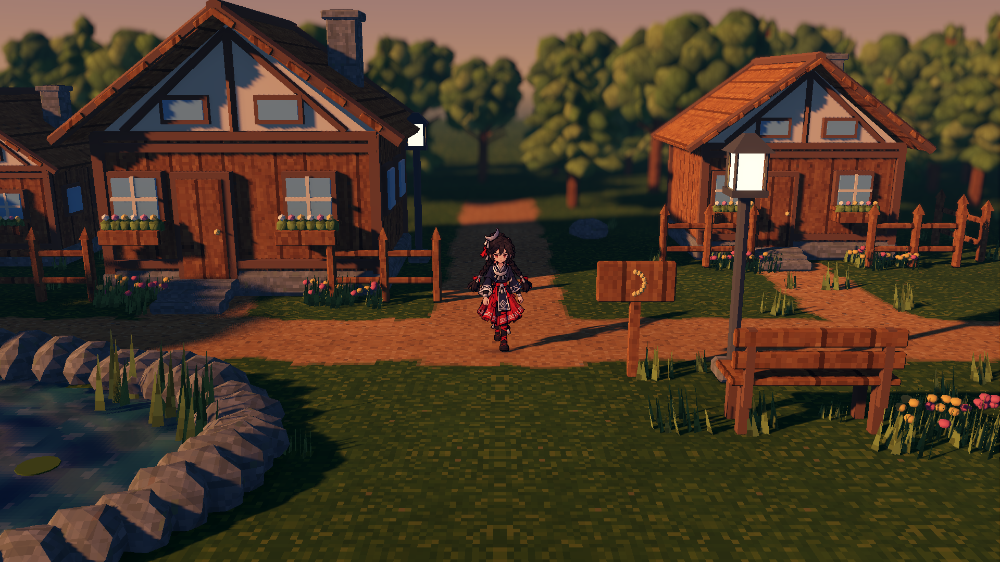
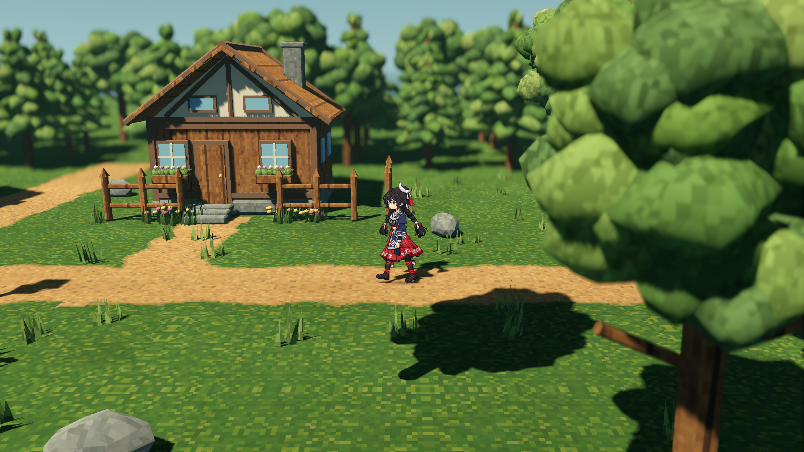

# 林间小村：参考镜头与人物比例修订

入口：`scenes/forest_hamlet_close.tscn`，独立继承村庄场景并固定本次近景参数。

日期：2026-10-22。对应用户补充要求：采用所附江南河街画面的镜头角度，可更近，同时保持月饰少女的正确比例。

## 当前实际画面





这两张图使用正常跟随相机的参数，截图时仅等待跟随稳定并隐藏操作界面。初始角色朝向为原四方向中的正面；行走继续使用原前、后、左、右动画。

## 镜头和构图

| 项目 | 当前值 |
|---|---|
| 俯角 | 14°，正面固定朝向 |
| 垂直 FOV | 39° |
| 相机相对焦点距离 | 12.75 米 |
| 相机偏移 | `(0, 3.084504, 12.371271)` |
| 焦点相对角色脚底 | `(0, 1.0, -0.6)` |
| 脚底位置 | 屏幕横向 50%，纵向约 62.69% |
| 原正面第 0 帧可见高度 | 约 22.1% 屏高 |
| 原 108 帧联合轮廓高度 | 约 23.24% 屏高 |
| 角色像素尺寸 | 原始 `0.009` 米/像素 |
| 角色和精灵缩放 | `(1, 1, 1)` |

用户参考图中的角色可见高度目测约为屏高 21.4%，脚底约在 61% 处。这两个参考值是截图测量估计，不用于改变角色体型。工程中江南河街的正面 F/W 镜头分别为 14°/12°；本次采用 14°，再调整距离与构图。焦点同时跟随角色地面高度，以免地形起伏改变相对构图。

人物的宽高比例由原始像素帧和完整朝向相机的精灵平面决定。没有通过单独缩放 X/Y 补偿相机俯角。角色的原颜色、法线、银饰蒙版、动画帧序、时长和脚底锚点保留。

## 低机位下的树木遮挡



近镜头检查发现，右侧前景树会挡住人物，因此增加了场景内的树实例渐隐：当树冠或树干位于相机与人物之间时，该棵树的所有网格在约 0.17 秒内淡出，离开后恢复。每棵树独立处理，保留树的位置、共享材质、投影配置和物理碰撞。

检测采用缓存的树世界包围盒和相机到角色平面的九条有限线段，带有进入/退出边距。它会在实际网格遮挡前稍早触发，以避免树冠空隙导致频繁闪动。当前树的位置固定；如果以后运行时移动或缩放树，需要重新建立遮挡缓存。

实现使用当前 Forward+ 的实例透明度。有关透明度与阴影的引擎行为，见 [Godot 官方 GeometryInstance3D 文档](https://docs.godotengine.org/en/stable/classes/class_geometryinstance3d.html#class-geometryinstance3d-property-transparency)。

## 本轮验证

确切状态、计数和运行文件指纹见 [validation.json](validation.json)。

- [close-runtime-report.json](close-runtime-report.json)：原始 108 帧复用、原尺寸、镜头构图、地图边界、碰撞、树遮挡恢复、完整六点行走和景深保护。
- [camera-gpu-report.json](camera-gpu-report.json)：实际 RTX 4070 SUPER / Forward+，1920×1080；正常游玩日光/黄昏、四方向行走帧、左右路线位置与五个比例探针，共 13 张截图。
- [billboard-gpu-report.json](billboard-gpu-report.json)：同一原始正面帧在 15°、35°、60° 俯角及 55° 偏航下均为 194×370 像素轮廓；相机角度没有引起纵向压缩。另有等比 1.25 倍探针检查变换缩放的保留。
- [assets-report.json](assets-report.json)：保留当前 AW 材质输出、九个模型及 345 个原角色文件的摘要核验。
- [make-test.json](make-test.json)：项目共用回归结果。
- [runtime-fingerprint.json](runtime-fingerprint.json)：截图对应的实际运行源文件和资产摘要。

这次修改属于相机、初始朝向和可见性处理；继续使用已有 AW/VGP 资产来源链。既有资源与审批身份没有因镜头修订而重建。此前的截图与验证保留在各自目录。

## 运行和复现

在工程根目录执行：

```sh
make forest-close-run
```

或在 Godot 打开 [forest_hamlet_close.tscn](../../../scenes/forest_hamlet_close.tscn) 后按 F6。WASD/方向键行走，T 切换日光与黄昏，G 自动游览，M 打开/收起控制台。

重新生成本轮专用验收：

```sh
make forest-close-test
make test
python3 tools/forest_hamlet/run.py capture-camera --output build/forest-hamlet/camera-review-new
```

捕获使用后台实际 GPU 视口。`--no-route` 可用于静态调图，但不构成完整路线验收。

关键代码：[相机与构图](../../../scripts/forest_hamlet/close_scene.gd)、[树遮挡渐隐](../../../scripts/forest_hamlet/occlusion.gd)、[原角色复用](../../../scripts/forest_hamlet/actor.gd)、[专用 GPU 捕获](../../../tools/forest_hamlet/capture_camera.gd)。
