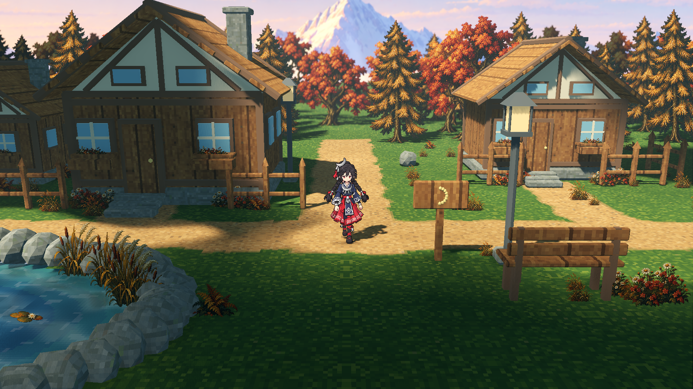
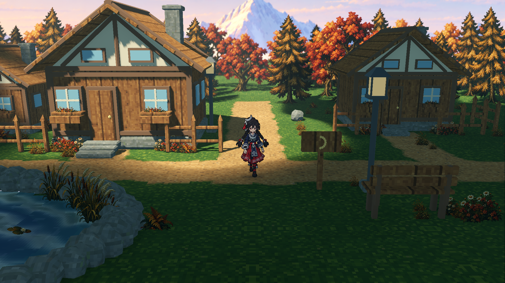
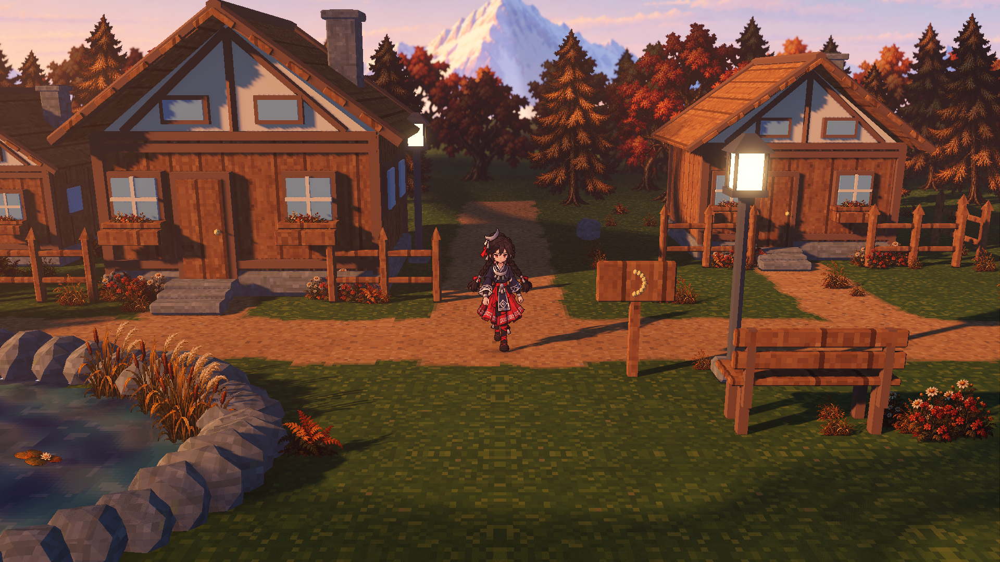

> 历史记录：本页为云影初版 r1；包含独立全局光变的最终版本见 [r2](../atmosphere-r2-20261022/README.md)。此处保留当时的原始截图、报告与运行指纹。

# 雪山远景与流动光照：场景交付

本轮在既有 hd-2d-godot 林间小村中接入了用户选定的柔和雪山原画，并完成法线重光照、动态云影、原生体积雾与 WorldEnvironment Glow。默认入口为 `make forest-close-run`；总览入口仍为 `make forest-run`。

## 实机画面







上面三张均为 1920 × 1080 的实际 Forward+ GPU 读回，PNG 原始字节与捕获报告 SHA-256 一致。

## 实现

| 部分 | 当前行为 |
|---|---|
| 雪山远景 | 使用选定的 1983 × 793 远景原画，原颜色 PNG 字节不变；山面进入中央树冠间开口，峰尖轻微裁顶 |
| 法线受光 | 在 10 个山体上标注 20 个大雪面，按实际主光方向进行柔和重光照；天空和雾带保持平法线 |
| 视差 | 远景板位于视深 135 米，水平移动保留 0.35 倍相对位移；当前是完整单板的视差 |
| 天空遮挡 | 24 米高处的云影遮挡层参与原生太阳投影，光斑随时间经过地面、房屋、植被及角色 |
| 明暗层次 | 恒定冷色环境补光保留阴影可读性；日景填光 0.55，方向光软阴影为 Ultra |
| 空间光感 | 低密度原生体积雾：日光 0.0030、黄昏 0.0038，独立开关 |
| 光晕 | WorldEnvironment Glow 强度 0.42、阈值 0.95，以灯具和受光亮部为主 |

当前近镜头仍为 14° 俯角、39° FOV。月饰少女保留原资源、单位缩放与 0.009 pixel_size，完整动画轮廓约占画高 23.24%。218 个植被实例继续采用颜色图与法线图精灵。

## 使用

```sh
make forest-close-run
```

| 按键 | 功能 |
|---|---|
| WASD / 方向键 | 行走 |
| T | 日光 / 黄昏 |
| G | 六路点自动游览 |
| M | 展开 / 收起效果面板 |
| H | 动态云影 |
| L | 体积雾与空间光感 |
| B | Glow 光晕 |
| R | 雪山法线重光照 |
| P | 远景视差 |
| N / O / V | 地面法线 / 景深 / 植被微风 |
| K | 保存当前实机截图 |

## 验证

| 项目 | 结果 |
|---|---|
| 新远景资源 | 15 项通过 |
| 场景接口、镜头、覆盖与开关 | 34 项通过 |
| 实机 GPU 捕获 | 20 项通过，12 张原始 PNG |
| GPU 像素对照 | 41 项通过 |
| 原角色与原模型资源 | 48 项回归通过，345 个角色原文件保持原 SHA，9 个原 GLB 保留 |
| 植被 | 126 项资源检查、28 项运行检查通过 |
| 近景与总览 | 27 项近景、77 项场景运行检查通过 |
| 项目共用回归 | `make test` 返回 0 |
| AW 原生 Godot 验证 | `godot.verify` 完成，34 项检查通过 |

六路点路线实际完成，模拟时间 22.45 秒，角色全程完整入镜并处于清晰范围。雪脊的预期横移为 −96.57 像素，GPU 图像匹配实测 −97 像素。

法线左右光方向对照中，开启法线后的平均 RGB 差为 2.284；关闭后为 0。Glow 对照有 25,032 个像素超过 2 级 RGB 差，体积雾对照有 798,432 个像素超过该阈值。三个云影接收区域分别取地面、房屋和植被，均具有实际明暗变化。

运行文件指纹：

```text
dddfa0e75fd426491a5d3e6b55b1725dd250e60aaf369e12407b597194c5f232
```

[GPU 捕获记录](atmosphere-gpu-report.json) · [像素测量](atmosphere-gpu-pixel-report.json) · [运行检查](atmosphere-runtime-report.json) · [资源检查](atmosphere-assets-report.json)

## 来源和实现范围

原图 SHA-256：`fa11b07fc545379570c1a86f8f5c70a5d5fe01c38aa4ffd2306ad6c5d381ce8c`。颜色文件逐字节复用，法线由独立的大面标注配方生成；不使用颜色亮度反推高度。云遮罩使用固定种子 20261022。

背景采用一块完整远景板，天空、远山、主雪峰与雾带没有独立的层间运动。法线对已绘制光照的原画做风格化重光照，因此不会替代真实山体几何，也不会重建山体投影。云影影响太阳直射，恒定环境补光与体积雾共同维持空间层次。

技术检查确认运行效果；审美状态保留待用户审阅。本轮未提交或推送代码。
