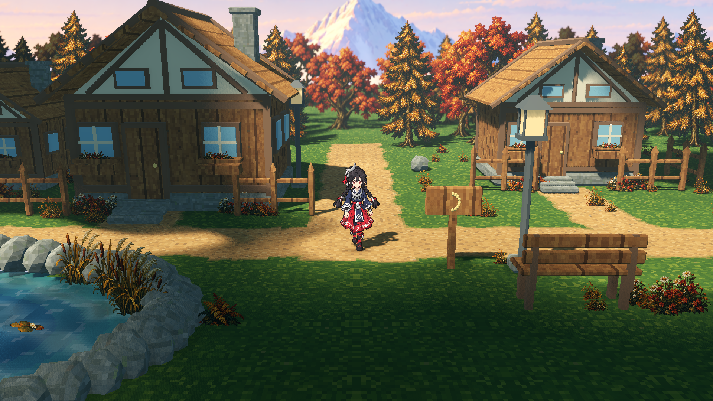
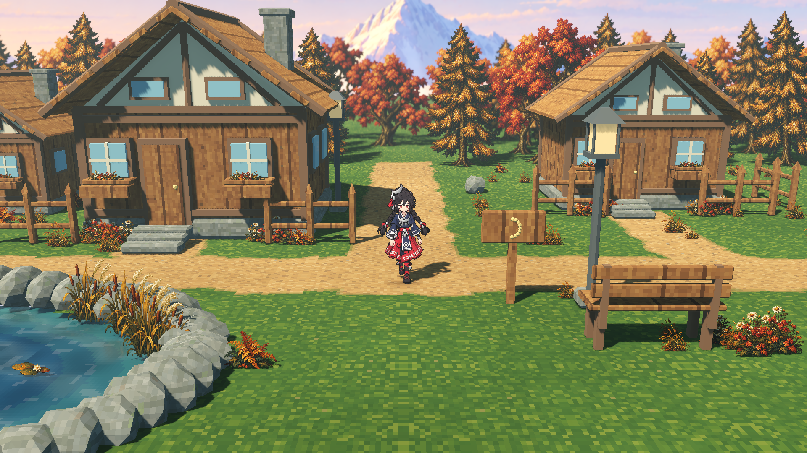
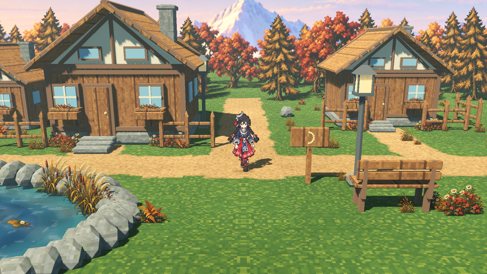

# 雪山远景与动态环境光 · Atmosphere r2

版本：`forest-hamlet-20261022-atmosphere-r2` · 日期：2026-10-22 · 场景：`res://scenes/forest_hamlet_close.tscn`

本版在近机位村落中接入雪山远景、山体法线重光照、横向视差、原生流动云影、体积光和 WorldEnvironment Glow，并增加了**与云影独立运行的全局光强变化**。月饰少女沿用原角色，近机位构图与人物比例保留；218 个植被实例继续使用图像精灵与配对法线。

场景、资源和真实 GPU 对照已经通过本版验证：资源 15 项、运行时 47 项、GPU 捕获 26 项、像素分析 65 项；15 张 1920 × 1080 原始截图及六路点实际行走全部完成。仓库 `make test` 已通过。AW 原生 Godot 验证、正式 delivery 导出与校验、VGP 候选版本与评审轮次创建均已完成。VGP 就绪检查为 `ready = true`、`issues = []`；美术评审保留为 `concept_design / pending_review`。

## 场景预览

日景基准：云影开启，全局变化保持在 `t = 0` 的中性倍率，人物、地面、房屋与植被同时参与场景光照。



另见[黄昏场景](close-dusk-atmosphere.png)、[云影移至 24 秒](close-day-clouds-b.png)和[关闭云影](close-day-clouds-off.png)。这些图使用同一近机位，便于直接比较光照。

## 已完成的效果

| 效果 | 当前实现与作用 |
| --- | --- |
| 雪山远景 | 使用已确认的 1983 × 793 原始远景图，保留原图字节与宽高比。天空、山体和薄雾属于一张完整背景板。 |
| 山体法线 | 山体的大块坡面使用配对切线空间法线，按太阳方向作动态重光照。法线来自明确标注的坡面几何；天空与底部雾保持平法线。 |
| 远景视差 | 单张远景板在相机横移时有限跟随，形成相对于村落的真实屏幕位移。行走范围内完成了覆盖检查，未露出背景板边界。 |
| 流动云影 | 高空遮挡几何参与 Godot 原生阴影通道，让房屋、植被和地面在不同位置受到不均匀日照。云场使用可复现的独立时钟。 |
| 全局不规则光变 | 独立的低频多尺度噪声分别调节原生太阳光与环境光能量。太阳与环境光使用不同种子通道；云影关闭时仍然生效。 |
| 体积光 | 原生体积雾承接受遮挡的太阳光，形成空气中的明暗层次，可独立开关。 |
| 光晕 | WorldEnvironment 的 Glow 对高亮处产生可测的柔和溢光，保持人物和环境的像素细节。 |

云影负责光照在空间中的分布，全局变化负责太阳光和环境光随时间的缓慢强弱变化。两个模块的时钟与开关独立，在正常游玩中叠加运行。关闭全局变化会立即恢复当前日景或黄昏的基准能量；反复切换时间预设不会累计放大或压暗。

**远景的作用范围：**雪山板使用 `unshaded` 材质和自身的法线重光照逻辑，保留绘制的颜色与光感。它响应太阳方向及日景／黄昏预设，但**不随全局原生太阳光、环境光的能量倍率同步变亮变暗**。本版的全局光强变化作用于参与原生受光的场景物体。远景目前是一张完整图板；没有把它声明为多张独立绘制的分层资产。

## 独立全局光变：实机强弱对照

以下两张图均关闭云影，并固定相机、角色帧、太阳方向和后处理。测试逐秒扫描 `0–90 s`，按太阳光倍率选择弱光 `57 s` 与强光 `84 s`，每次 GPU 读回期间冻结所有相关时钟。

| 弱光 · 57 秒 | 强光 · 84 秒 |
| --- | --- |
|  |  |

| 实测项 | 弱光 57 秒 | 强光 84 秒 | 关闭全局变化 |
| --- | ---: | ---: | ---: |
| 太阳光倍率 | 0.916079 | 1.121005 | 1.000000 |
| 原生太阳光能量 | 1.328315 | 1.625457 | 1.450000 |
| 环境光倍率 | 0.964339 | 1.066776 | 1.000000 |
| 原生环境光能量 | 0.530387 | 0.586727 | 0.550000 |
| 画面平均灰度值，0–255 | 124.0218 | 133.3547 | 127.9654 |

弱光与强光之间，**1,906,257 个像素**超过差值阈值，占全帧 **91.93%**；全帧平均 RGB 绝对差为 **8.7269 / 255**。地面、房屋、植被三个固定区域的平均 RGB 差分别为 **9.8685、9.8670、8.2944**，说明变化确实落到各类受光物体上。完整数据来自[像素分析报告](atmosphere-gpu-pixel-report.json)的 `global_light` 字段。

[关闭全局变化的基准图](close-day-global-off.png)恢复日景的太阳光 `1.45`、环境光 `0.55`。它与独立的 `t = 0` 中性基准相比，没有像素超过差值阈值，平均 RGB 差为 `0.0811 / 255`。黄昏基准为太阳光 `1.15`、环境光 `0.40`，运行时测试同样验证了关闭恢复、重开复现和往返切换无漂移。

本轮 91 个时间采样中的太阳光倍率范围为 `0.916079–1.121005`，环境光倍率范围为 `0.944128–1.068751`。这些是本轮采样结果；模块的硬边界分别是 `0.82–1.18` 与 `0.90–1.10`。两路变化保持连续，默认 `t = 0` 两个倍率均为 `1`。

## 近机位与原有资产保持

| 项目 | 本版验证结果 |
| --- | --- |
| 相机俯角 | 14° |
| 视场角 | 39° |
| 月饰少女完整轮廓的屏幕高度 | 23.24485% |
| 角色图像像素尺寸 | `0.009`，等比显示 |
| 人物轮廓 | 完整留在画面内；横移检查保持近机位尺度 |
| 植被 | 218 个既有图像植被实例保留 |
| 路线 | 6 / 6 路点完成，实际行走 22.45 秒 |

上述相机、轮廓和植被结果见[运行时报告](atmosphere-runtime-report.json)与[GPU 捕获报告](atmosphere-gpu-report.json)。自动路线实际推进了全局光变时钟，记录了起点、左侧、右侧和终点四个状态；视差截图读回时临时回到中性光照，完成后恢复行走中的时间，避免把明暗变化混入位移测量。

## 操作

从项目根目录启动近机位场景：

```bash
python3 tools/forest_hamlet/run.py run-close
```

| 按键 | 功能 |
| --- | --- |
| `W A S D` / 方向键 | 移动角色；手动移动会停止自动路线 |
| `T` | 日景／黄昏切换 |
| `J` | 独立全局光强变化开关；关闭恢复当前预设的原生光照基值 |
| `H` | 流动云影开关 |
| `L` | 体积光／体积雾开关 |
| `B` | WorldEnvironment Glow 开关 |
| `R` | 雪山法线重光照开关 |
| `P` | 雪山横向视差开关 |
| `N` | 地面法线开关 |
| `O` | 景深开关 |
| `V` | 植被风动开关 |
| `G` | 启动／停止六路点自动路线 |
| `M` | 显示／隐藏参数面板 |
| `K` | 截图 |
| `Esc` | 停止路线、关闭面板，或显示／关闭退出确认 |

观察独立光变时可以先按 `H` 关闭云影，再用 `J` 对比变化与固定基准；按 `H` 恢复后即可观察两种效果叠加。检查雪山视差时保持 `P` 开启，向左右移动；`R` 可单独切换山体的法线响应。

## 验证结果与证据范围

本轮图像由 **NVIDIA GeForce RTX 4070 SUPER** 使用 Godot **Forward+** 实际渲染并读回，尺寸均为 **1920 × 1080**。截图保留原始输出；像素分析使用同批图像的 SHA-256，且运行时指纹一致。

| 验证层 | 实际结果 | 证据文件 |
| --- | --- | --- |
| 原始图片与技术贴图 | 15 / 15 通过 | [资源报告](atmosphere-assets-report.json) |
| Godot 运行时 | 47 / 47 通过 | [运行时报告](atmosphere-runtime-report.json) |
| GPU 捕获与状态 | 26 / 26 通过，15 张图，完整 6 路点 | [GPU 捕获报告](atmosphere-gpu-report.json) |
| GPU 像素对照 | 65 / 65 通过 | [像素分析报告](atmosphere-gpu-pixel-report.json) |
| 仓库完整测试 | `make test` 退出码 0，通过，8.946 秒 | [仓库测试报告](make-test-report.json) |
| AW 原生 Godot 验证 | `completed`；47 项通过；冻结 1,549 文件、110,349,949 字节 | [原生摘要](aw-godot-summary.json) · [回执](aw-godot-receipt.json) · [运行时报告](aw-godot-runtime-report.json) |
| AW 交付 | `delivery.export` 与 `delivery.verify` 已完成；3 幅主资源；外部证据另有 61 项独立冻结来源 | [AW 摘要](aw-summary.json) · [交付清单](aw-delivery-manifest.json) · [校验回执](aw-delivery-verification.json) · [独立冻结清单](independent-frozen-inputs.json) |
| VGP | 63 个唯一来源文件入包，3 幅 1983 × 793 主资源；`ready = true`、`issues = []` | [VGP 摘要](vgp-summary.json) · [就绪检查](vgp-check.json) · [冻结文件清单](vgp-frozen-files.json) |

AW 原生 Godot 验证运行的是完整资源闭包上的无界面运行时检查，回执中的 `rendered` 为 `false`。实际 GPU 截图来自上面的独立显卡捕获流程。AW 原生交付选择已完成 Godot 运行内的颜色图、法线图、区域图及相关运行证据；外部 15 张 GPU 图与报告分别冻结并追溯，不混称为该原生 Godot 运行产生的渲染结果。

### 真实像素对照

以下差值均以 8 位通道值计；“变化像素”沿用分析器的超过 2 阈值定义。对照组固定角色帧、风动、水流及未被测的设置，并等待渲染与体积雾历史稳定。

| 对照 | 实测结果 |
| --- | --- |
| 云影从 0 秒移动至 24 秒 | 1,448,547 个像素变化，平均 RGB 差 26.9434；地面、房屋、植被区域均产生变化，且空间变化不均匀。此组全局倍率固定为 1。 |
| 全局强／弱光，云影关闭 | 1,906,257 个像素变化，平均 RGB 差 8.7269；原生太阳光与环境光能量的读回值符合各自倍率。 |
| Glow 开／关 | 25,032 个像素变化，平均 RGB 差 0.4862；日景中灰度值达到或超过 250 的像素占比约 0.1148%。 |
| 体积光开／关 | 798,432 个像素变化，平均 RGB 差 2.9005。 |
| 雪山法线开启时改变光向 | 389,578 个像素变化，平均 RGB 差 2.2840。 |
| 雪山法线关闭时相同的光向对照 | 0 个像素变化，平均差 0；用于核实法线本身产生了方向响应。此组关闭全局光变。 |
| 左右行走的雪脊视差 | 可见雪脊实测横移 −97 px；投影预期 −96.5705 px。匹配区域灰度误差 0.8274，低于假设不移动时的 48.8999。 |

### 15 张原始截图

| 用途 | 图像 |
| --- | --- |
| 云影固定时刻与关闭基准 | [0 秒](close-day-clouds-a.png) · [关闭](close-day-clouds-off.png) · [24 秒](close-day-clouds-b.png) |
| 后处理与黄昏 | [关闭 Glow](close-day-glow-off.png) · [关闭体积光](close-day-atmosphere-off.png) · [黄昏](close-dusk-atmosphere.png) |
| 独立全局光变 | [弱光 57 秒](close-day-global-weak.png) · [强光 84 秒](close-day-global-strong.png) · [关闭全局变化](close-day-global-off.png) |
| 实际行走与视差 | [左侧](close-route-left.png) · [右侧](close-route-right.png) |
| 雪山法线方向对照 | [左光／开启](snow-left-normals-on.png) · [左光／关闭](snow-left-normals-off.png) · [右光／开启](snow-right-normals-on.png) · [右光／关闭](snow-right-normals-off.png) |

## 复现与版本身份

从项目根目录运行以下命令，分别执行资源／运行时验证与完整 GPU 对照。GPU 捕获需要桌面显卡环境；预览模式只用于调参，不能替代完整验收。

```bash
python3 tools/forest_hamlet/run_atmosphere.py test \
  --output build/forest-hamlet/atmosphere-r2-final

python3 tools/forest_hamlet/run_atmosphere.py capture \
  --output build/forest-hamlet/atmosphere-r2-final
```

| 身份 | SHA-256 |
| --- | --- |
| 本版运行时指纹 | `9ea90603ae27c7853901580c1fdbbe19411087a8f14f8b4be9dfd2cba7733264` |
| 原始 GPU 报告 | `8c9c7acf6959bc3e7326f72c31b2690ac28c2e9c80430f174607b28ffaeccd67` |
| 已确认雪山颜色原图 | `fa11b07fc545379570c1a86f8f5c70a5d5fe01c38aa4ffd2306ad6c5d381ce8c` |

像素报告中的 `capture_sha256` 对应上述原始 GPU 报告。r1 的既有证据保留，本版使用独立的 r2 输出与归档目录。正式交付与 VGP 评审使用下面各自的真实运行身份；已完成的原生 r2 验证保留原始回执，通过摘要路径和哈希关联到后续交付。首次 VGP 提交因 64 文件上限失败，后续按来源路径去除重复打包，完整保留证据并以 63 个文件成功提交；首次失败记录保留作审计。

| 工作流身份 | 实际值 |
| --- | --- |
| 原生 AW `godot.verify` run | `forest-hamlet-20261022-atmosphere-r2` |
| 正式 AW delivery run | `forest-hamlet-20261022-atmosphere-r2-delivery2` |
| AW delivery ID | `delivery-09686e77c750744fb67593e943a7e2c5baa5d99df7fc00c10037221d7211ad32` |
| AW ZIP SHA-256 | `6897faaeb542cbe761c65c30e7728e0289d3aeb3fcd06a61d62db3248f5f043e` |
| VGP review run | `forest-hamlet-20261022-atmosphere-r2-review2` |
| VGP asset | `52975eea-0437-4f23-96a3-13326f54e762` |
| VGP revision | `bb5be0ab-eed7-4d77-b94d-e058bf001593` |
| VGP review round | `69395dbc-d658-486d-8571-0986c59fd7d8` |

归档总索引见 [validation.json](validation.json)。VGP 维持 `concept_design / pending_review`，本轮创建的美术决策和阶段准入记录均为 0；用户美术确认仍为 `pending`。工作流完成状态和人工视觉认可分别记录，技术检查通过本身不代表用户已批准最终美术效果。
