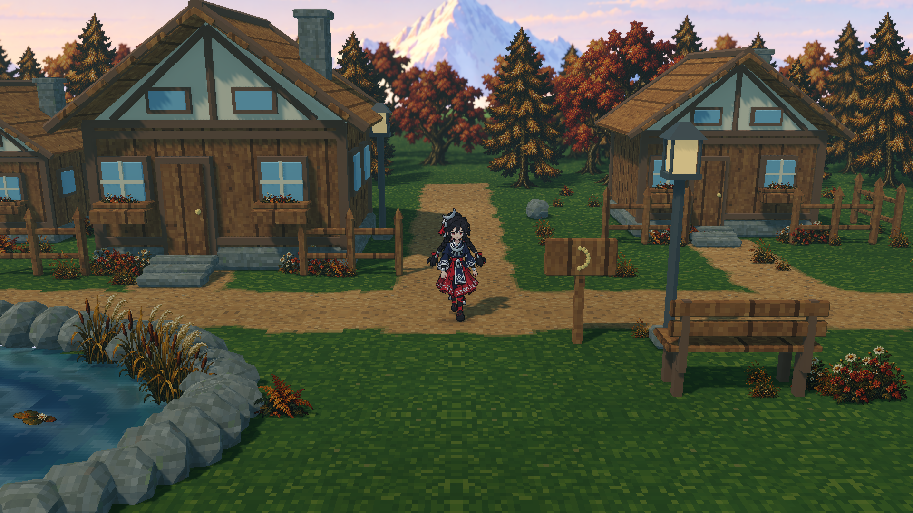

# 云层实时调节 · 2026-10-22 r4

**已在实际 Godot 场景中加入两个独立滑块，并将最大遮光开放到 80%。** 默认仍使用此前薄云约 10%、厚云 30% 的效果。按 M 打开或收起右侧中文面板，即可亲自调整。

## 亲自调整

| 控件 | 范围与默认 | 含义 |
|---|---|---|
| 透光对比 · 最大遮光 | 0–80%，默认 30% | 越大则云下越暗。最厚云在 80% 时保留 20% 太阳直射光；0% 时没有云影明暗差。 |
| 云层密度 | 0–100%，默认 50% | 独立改变覆盖与厚薄分布。0% 无云，50% 默认分布，100% 满布厚云。 |
| 保存参数 | 点击保存 | 下次正常启动会自动沿用这两个参数。 |
| 读取已保存 | 点击读取 | 恢复最近一次保存的参数。 |
| 恢复默认 | 30% / 50% | 立即恢复默认预览；再次保存后才作为下次启动设置。 |

拖动即时生效。选中滑块后，左右方向键每步调整 1 个百分点，并暂停角色的键盘行走输入；点击场景、按 WASD 或收起面板即可继续行走。面板在 [1280×720](cloud-tuning-panel-720.png) 中也可操作，下部效果开关可以滚动查看。

厚薄曲线按所选最大遮光缩放，薄云代表值为最大值的三分之一：默认最大 30% 对应薄云约 10%，最大 80% 对应薄云约 26.7%；云边缘仍平滑过渡到零遮光。想单独比较云影，可用 **J** 暂时关闭独立全局光变。**H** 开关云影，**T** 切换日光/黄昏，**L/B** 分别控制体积光与辉光。

这里的 80% 指云对太阳直射光的削弱量。环境补光、材质、体积散射和色调映射仍参与最终画面，因此屏幕 RGB 不按 80% 简单变暗。最大值实际画面见下图，参数为最大遮光 80%、密度 100%。

## 实现与实际验证

两路原生方向光按 `1 − 最大遮光` 和 `最大遮光` 分配太阳能量，默认 70/30，最大设置 20/80，零对比 100/0。云敏感分支接收连续 alpha hash 云投影，普通物体阴影在两路中保留。密度只调整既有固定种子的平滑云场；角色、近景镜头、218 个图像植被及雪山远景保持原有构成。详细接口和保存方式见 [云层调节说明](../../cloud-tuning-r4.md)。

| 验证 | 本轮实际结果 | 原始记录 |
|---|---|---|
| 场景运行与控件绑定 | 20 项通过 | [runtime](cloud-tuning-runtime-report.json) |
| 实际 Forward+ GPU | 33 项通过，9 张原始 PNG | [GPU](cloud-tuning-gpu-report.json) |
| 原始图像像素比较 | 58 项通过 | [pixel](cloud-tuning-pixel-report.json) |
| 项目检查 | `make test` 通过，9.330 秒 | [make test](make-test-report.json) |
| AW 原生 Godot 验证 | 20 项通过，1562 文件、110492897 字节的冻结快照 | [AW Godot](aw-godot-summary.json) |
| AW 交付及校验 | completed，68 项独立来源/证据 | [AW summary](aw-summary.json)、[独立复核](aw-delivery-audit.json) |
| VGP | ready=true、issues=[]，后继候选待审阅 | [检查](vgp-check.json)、[VGP summary](vgp-summary.json) |
| 归档完整性 | 36 个文件逐一校验散列，其中 9 张 PNG；另附 validation 索引 | [validation](validation.json) |

实际鼠标事件将密度从 50% 调到 24%，着色器同步为 0.24；方向键成功再增加一步，收起面板后正确恢复此前的角色控制状态。80% 满云画面相较 30% 满云画面的平均绝对 RGB 差为 **31.343**，1,907,319 个像素的亮度差大于 2，证明上限实际生效。零对比与零密度两个晴空端点的平均绝对 RGB 差为 **0.0702**。这些数值是色调映射后的画面比较，不是新增的光照辐射测量。

本轮验证范围是新控件、最大值、保存/读取、输入与布局。r3 的六路点游览及专用透光探针仍属于其历史证据，没有将旧结果标成此次重新测量。运行与截图耗时也不作为游戏帧率结论。

## 原始图像

| 画面 | 最大遮光 | 密度 |
|---|---:|---:|
| [默认](cloud-tuning-default.png) | 30% | 50% |
| [较弱对比](cloud-tuning-contrast-low.png) | 10% | 50% |
| [零对比](cloud-tuning-contrast-zero.png) | 0% | 50% |
| [无云](cloud-tuning-density-zero.png) | 30% | 0% |
| [默认上限满云](cloud-tuning-density-full.png) | 30% | 100% |
| [最大上限满云](cloud-tuning-contrast-maximum.png) | 80% | 100% |
| [1080p 面板](cloud-tuning-panel-1080.png) | 30% | 50% |
| [720p 面板](cloud-tuning-panel-720.png) | 30% | 50% |
| [720p 真实鼠标调节](cloud-tuning-input-720.png) | 30% | 24% |

## AW / VGP 来源链

| 项目 | 本轮身份 |
|---|---|
| Run | `forest-hamlet-20261022-cloud-tuning-r4` |
| Runtime fingerprint | `afa098af1ecf1412e0169ace59832bae7a53ee6578159ce5e56427829e5dc029` |
| AW native source closure | `9ec6c495d2ea72b0a1660b55a83fc0e38ab6b765b3d6f9dbbb40991c006eacef` |
| AW Delivery | `delivery-bd1040f7d4d74416b5063bec5318d7c1a16b9542913eb526221b0b256f566592` |
| VGP Asset | `52975eea-0437-4f23-96a3-13326f54e762` |
| VGP Revision | `22f17788-3910-4bb3-92ea-c0ba7e376a28` |
| Parent Revision | `03bcb906-33ae-4917-a7fa-8120ac8ae6df` |
| Review Round | `1047b04f-01d0-49ff-a4cd-f6fb13841eec` |
| Previous Round | `0cb738ba-f8d4-486e-8daa-b11be1ddbce5` |

VGP 保存 70 项逻辑文件，实际使用 14 个附件：13 张直接 PNG 和一个包含其他依赖的确定性证据 ZIP。原图当前引用和继承引用均保留。状态为 `concept_design` / `pending_review`，未创建人工批准或阶段准入。

归档保留公共收据。原生 AW run 与 delivery verify 的公共副本明确标注路径处理，并通过原始收据 SHA 绑定完整记录；实际冻结输入及原始回执没有改写。索引不包含自身或本说明，以免形成循环散列。

## 运行

在项目根目录执行 `make forest-close-run`，或在 Godot 中打开 `scenes/forest_hamlet_close.tscn` 后按 F6。原默认江南河街入口保持原样。所有参数调整均可直接在运行场景中完成。
