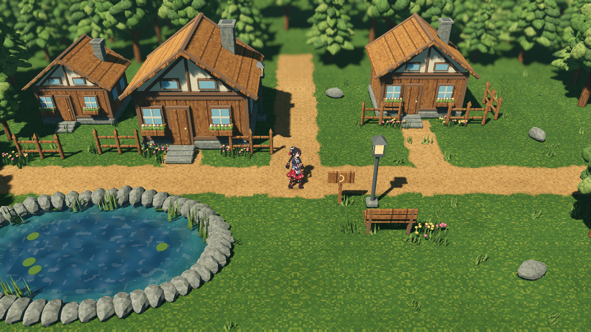
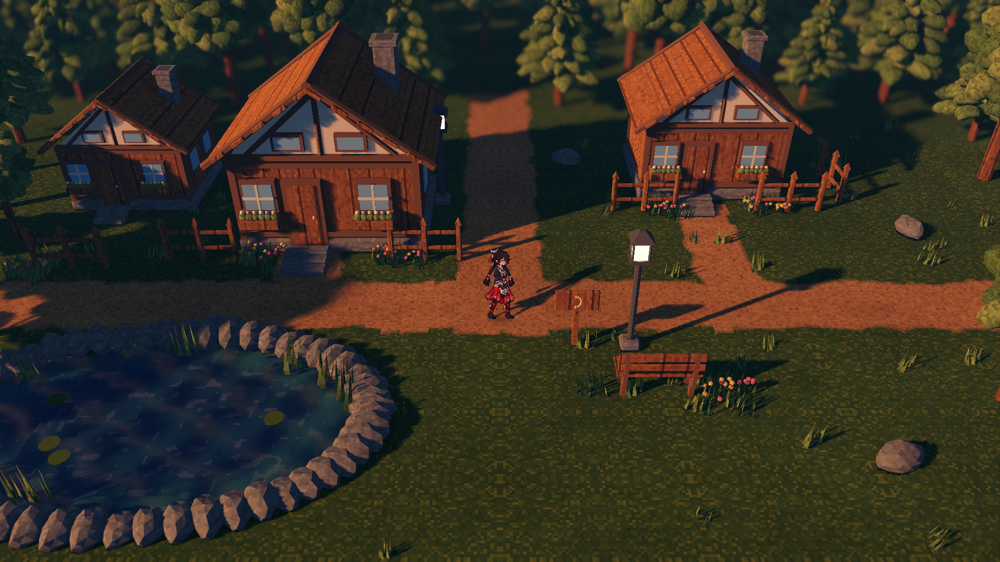

# pixel-r2 · 像素材质、角色比例与参考机位

此修订对应 2026-10-22 用户提出的三项修正，以及补充村落截图的机位要求。场景入口为 `res://scenes/forest_hamlet.tscn`；在工程根目录执行 `make forest-run`，或在 Godot 中打开该场景并按 F6。

## 当前画面





截图来自实际 Forward+ GPU 运行，1920×1080。它们用于检查实现与构图，用户美术审阅仍独立保留。

## 机位与角色

补图保存在 `art/inputs/forest-hamlet/camera-reference-20261022.png`，SHA-256 为 `9046d2e2a350566e9c42b8f8bcf5d6e5fb9619046218a215b5ade12e075b7405`。该图仅作为构图参考，不接入运行时贴图。

| 参数 | 最终值 |
|---|---|
| 相机偏移 | `(0, 12, 17.5)` |
| 到跟随焦点的距离 | 21.2191 m，较初版 26.5149 m 约缩短 20% |
| 俯角 / FOV | 34.439° / 39° |
| 角色完整动画可见范围 | 13.6036% 画高；单帧轮廓会随原动画变化 |
| 脚底屏幕位置 | `(50.0%, 56.92596%)` |
| 原角色尺寸 | `pixel_size = 0.009`、单位缩放、原脚底枢轴 |
| 跟随 | 水平 1:1 跟随，指数平滑；固定焦点高度及边界限制 |

完整 billboard 消除了旧自定义 shader 在俯视时的高度压缩。主相机基底同时用于可见 pass 与阴影 pass；保留模型 scale 并同步逆转置法线矩阵。四方向共 108 帧动画、颜色、法线、银饰蒙版仍使用原数据，345 个原文件逐个核对摘要不变。精灵平面始终面向相机，原动画方向随移动切换。

景深使用角色在相机空间的实际深度；从头到脚位于同一清晰平面。主构图保持中央角色、左下池塘和上方村屋。外侧新增仅供显示的地面裙边，补齐镜头跟随时原网格之外的空白；原行走区域、碰撞网格和池塘洞口未改。 前景树冠遮挡角色时，接入既有的遮挡检测与渐隐恢复；右侧路点实际 GPU 截图已检查角色完整可见。

## 像素材质

四张运行材质由新的 AW `world.compile` 正式加工，原 ImageGen 母图不变：

| 材质 | 画布 | 实际使用颜色数 |
|---|---|---:|
| grass | 64×64 | 17 |
| earth | 64×64 | 34 |
| wood | 64×64 | 27 |
| stone | 64×64 | 27 |

共享来源色板为 64 色。输入每种材质选取最多 16 个原图代表色，合并后由 AW 映射，所以每张最终图的实际颜色数不限定为 16。对边逐像素相同，运行 PNG 与官方 AW 输出字节一致。

地面和道具使用 16 texel/m 的基准密度与 nearest 取样。木屋和小道具使用世界坐标三向投射，避免每片屋瓦重复铺满整张图；降低木纹和石纹对比，以色块支持物体结构。路径混合、植物色簇和水纹也作有限级别处理，保留三维受光、阴影、反射和景深。

九个模型重新导出内嵌的新材质，原确定性几何生成器和 seed `20261022` 不变，Blender 源文件与清单可重建。

## 验证证据

- [验证总表](evidence/validation.json)：最终运行指纹、截图数量、路线和加工身份。
- [资源检查](evidence/assets-report.json)：48 项检查，包含 345 个原角色文件不变、AW 字节一致和九个模型。
- [运行检查](evidence/runtime-report.json)：61 项检查，包含实际行走、镜头边界、清晰深度范围、遮挡恢复和六路点完成。
- [GPU 截图状态](evidence/gpu-report.json)：22 张实际截图，包含左右及北部路线点、昼夜、材质开关和近景。
- [Billboard GPU 轮廓](evidence/billboard-gpu-report.json)：15°、35°、60° 俯角和 55° 侧转均为 194×370 px；1.25 倍 scale 为 242×463 px，符合像素取整。
- [当前运行文件指纹](evidence/runtime-fingerprint.json)：归档时重新核对实际文件。
- [共用场景回归](evidence/shared-regression.json)：`make test` 与 `make canal-test` 均通过；江南 12 组场景检查和 2 组相机检查期间，运行文件指纹保持不变。
- [AW 摘要](evidence/materials-summary.json) 与 [VGP 身份](evidence/vgp-summary.json)。

原 `docs/forest-hamlet/captures/`、`evidence/` 及 `revisions/r1-20261022/` 保留为历史。此轮迭代截图另存于 `build/forest-hamlet/`，不把中途机位的图作为最终证据。

## 生产身份与重现

AW 与 VGP 本版运行身份均为 `forest-hamlet-20261022-pixel-r2`。VGP 复用既有两个稳定 Asset 和 Case，从 `forest-hamlet-20261022-r2` 追加后继候选与审阅轮次。技术检查 ready、issues=[]；未创建用户美术批准或阶段入库。

```sh
make forest-test
python3 tools/forest_hamlet/run.py capture --output build/forest-hamlet/review-next
make test
```

素材加工与 VGP 后继登记步骤见上层 `pipeline.md`。修改母图、配方或加工实现后必须使用新的生产 run ID。当前修改已保存到工程，未提交或推送。
